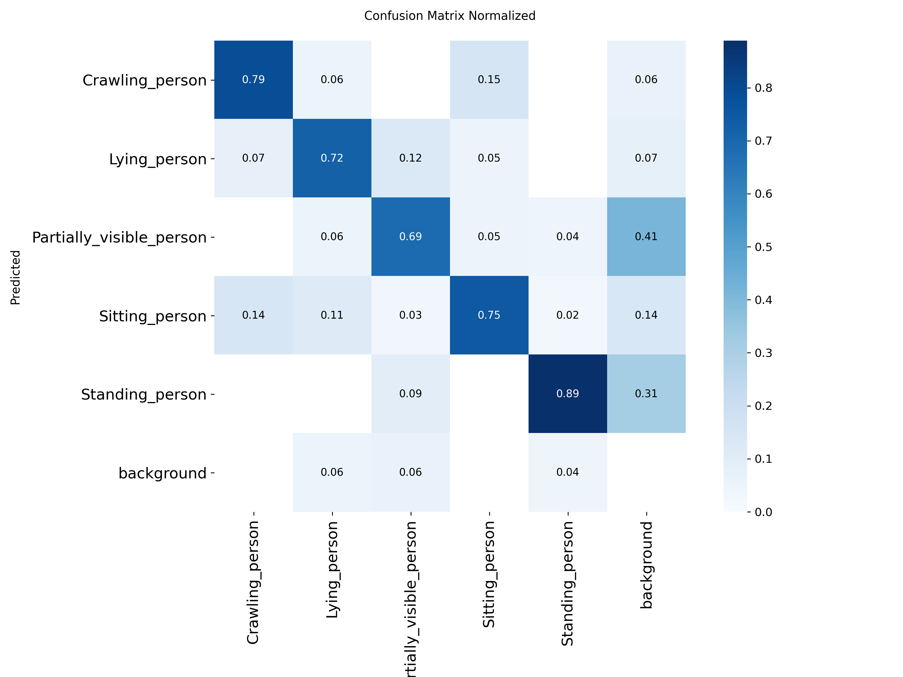
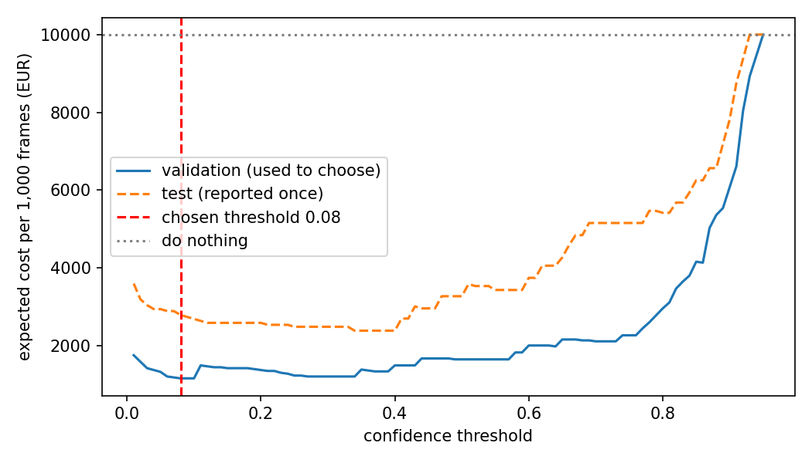

# Assignment 2 Report

- **Name**: Sofia Siso
- **Student ID**: 19304
- **Email**: ssiso.ieu2022@student.ie.edu
- **Group**: PPLEDBA 5A

## Business problem, and the cost of being wrong

A search-and-rescue team currently reviews camera footage by eye to find
missing hikers. This is slow and tiring, and people miss things after hours of
looking. This model supports one decision: for each camera frame, should the
team send someone to check it? The model flags frames that may contain a
person in distress, and a ground-team member then goes to look.

The positive class is a person who is **lying or crawling**, because those
people are the most likely to be injured and to need urgent help. Standing and
sitting people are the negative class: they are probably fine. A false alarm
means the model flags a rock, a log or a healthy hiker, and a rescuer wastes
minutes checking it. A miss means an injured person stays undiscovered
for longer, which costs extra search hours, crew and police time.

A miss is worse than a false alarm because every extra
hour can make an injury more serious, while a false alarm costs a few
minutes (and also takes a rescuer away from productive work). It is difficult
to put a cost on a person's life, so I price only
the operational cost of the delay (search hours, crew, aircraft) and I treat
the human cost as unpriced. My cost figures are therefore a lower bound. The remaining mismatch is that many images look staged (actors posing on open grass in daylight, with the person close to the camera), whereas real searches involve poor light, dense vegetation, bad weather and people far from the camera.

I assume a base rate of 20 in 1,000 frames that contain a person: a patrol on a routine trail mostly sees walkers, so a person lying or crawling is rare.

## Dataset

- **Workspace:** trash-32e51
- **Project:** search-rescue
- **Version:** 14
- **Link:** https://universe.roboflow.com/trash-32e51/search-rescue/dataset/14

**Why this dataset.** It has five posture classes: crawling, lying, partially
visible, sitting and standing person. Lying and crawling people are possibly
injured, while standing and sitting people are probably fine, which gives me
a clear positive class and a real cost asymmetry. It is also a hard dataset:
models already published on it reach about 46% mAP50, so mine will be
imperfect, which makes the human-review step more meaningful.

One image is a camera frame of a scene containing a person. A plain "person"
dataset could not separate people who may be injured from people who are
probably fine, which is the distinction my problem depends on.

Most images are taken from ground level, so I frame the use case as a camera
carried by a patrol officer, ranger or search volunteer walking an area, not
as a drone looking down.

## What the dataset's composition implies

- **Splits:** 1,524 train images (about 508 originals, tripled by
  augmentation), 146 validation and 70 test images. Only training is
  augmented.
- **Instances per class (train / valid / test):** Crawling 318 / 33 / 14,
  Lying 357 / 23 / 18, Partially visible 599 / 75 / 32, Sitting 600 / 52 / 20,
  Standing 791 / 79 / 45. Training counts include the augmented copies.
- **Object size:** median box is about 3.3% of image area in train and about
  2.4% in valid and test.

Interpretation: the test set has only 70 images, and only 14 crawling and 18
lying people, so one error moves recall by 5 to 7 points. I treat per-class
numbers for crawling, lying and partially visible people as indicative only.
The images I looked at show actors posing on open ground in daylight, close
to the camera, whereas real patrol footage would include clutter, poor
light, distance and frames with nobody in them. I therefore cannot conclude
that the recall I measured will hold on real footage.

## Finetuning and baselines

**Task and model.** Object detection with yolo11n, the smallest YOLO11 model,
fine-tuned from the COCO-pretrained weights. I chose the smallest model because
speed is critical in this use case: alerts have to reach a rescuer while the
person can still be helped, and the model would run on limited hardware such as
a laptop or a camera device. What I give up is some accuracy, especially on
small objects (my people are about 15% of the image width). I partly cover this
with human review of uncertain cases. I measured about 5 to 11 ms per image on
a Colab T4 GPU; this does not transfer to a field device.

**Training.** I trained once in Google Colab on a T4 GPU (about 20 minutes),
starting from yolo11n.pt on Roboflow dataset version 14, with 50 epochs, image
size 640, batch size 16, seed 0, and Ultralytics defaults otherwise. The
checkpoint with the best validation score, `best.pt`, is committed in
`weights/`. `train.py` contains the same settings. The model was never tuned
on the test split.

| Model | Task | Precision | Recall | AP50 | mAP50-95 |
|---|---|---|---|---|---|
| Finetuned yolo11n (5 classes) | any person (classes merged) | 0.865 | 0.760 | 0.833 | 0.514 |
| Pretrained COCO yolo11n, zero-shot | any person | 0.863 | 0.636 | 0.731 | 0.464 |
| Predict nothing | any person | n/a | 0.000 | 0.000 | 0.000 |
| Finetuned yolo11n (5 classes) | per class, all 5 | 0.696 | 0.657 | 0.666 | 0.453 |
| Pretrained COCO, zero-shot | per class | cannot do it: COCO only knows "person", not posture | | | |
| Predict nothing | per class | finds none of the 32 lying or crawling people | | | |

COCO is better than I would expect at finding people. Its precision matches mine (0.86). Where it loses is recall: it finds 64% of people against 76% for mine, and AP50 is 0.73 against 0.83. So finetuning helps with finding people, but only by about 10 points.

The real gain is posture. COCO can’t tell a lying person from a standing one. It only says “person”. For my problem, that’s the whole value. A camera that flags every person would send the team to check everyone, and by the test set’s mix that’s only about 1 in 4 truly lying or crawling. My model has a rough idea of who is likely in distress.

My model clearly beats both baselines on what matters for my problem, but my own numbers (any-person AP50 0.83, five-class AP50 0.67) show that telling postures apart is the hard part.

## Per-class evaluation and failure modes

Positive class: a person who is lying or crawling. All numbers are on the
70-image test split (129 people).

| Class | Test instances | Precision | Recall | AP50 |
|---|---|---|---|---|
| Crawling | 14 | 0.767 | 0.786 | 0.829 |
| Lying | 18 | 0.609 | 0.611 | 0.564 |
| Partially visible | 32 | 0.523 | 0.344 | 0.336 |
| Sitting | 20 | 0.730 | 0.700 | 0.737 |
| Standing | 45 | 0.851 | 0.844 | 0.865 |
| All | 129 | 0.696 | 0.657 | 0.666 |

Crawling carries my headline number (AP50 0.83). Lying is weaker (AP50 0.56),
and partially visible is the worst class (recall 0.34).

Where it fails (normalized confusion matrix, confidence cutoff about 0.25):

- 2 of 14 crawling and 2 of 18 lying people were labelled "sitting", which in
  my use case means an injured person judged to be fine. This is the costliest
  error.
- Crawling and lying are confused with each other only once each, which is
  harmless because both are positive.
- Very few people are missed entirely (1 lying, 2 partially visible, 2
  standing), so most errors are wrong posture, not missed people.
- Most false detections are labelled partially visible (41%) or standing
  (31%), and only 13% are labelled lying or crawling.
- Each percentage here is only one or two people, because the classes have
  14 to 45 test instances.

*Normalized confusion matrix on the 70-image test split. Columns are the true
class and rows are the predicted class, so each column adds up to 1. The
bottom row ("background") shows people the model missed entirely, and the
right column shows false detections.*

## Cost matrix and operating point

**Cost matrix (euros).** Positive = a person lying or crawling.

| | Model flags | Model does not flag |
|---|---|---|
| Person in distress | true positive: EUR 0 | **miss: EUR 500** |
| Not in distress | **false alarm: EUR 5** | true negative: EUR 0 |

- **False alarm, EUR 5:** I assume a rescuer needs about 5 minutes to walk
  over, look and confirm it is a false alarm, at a fully loaded staff cost
  of about EUR 60 per hour (wages, equipment and overhead).
- **Miss, EUR 500:** the operational cost of finding the person later (extra
  search time and crew). I chose EUR 500 as a deliberately conservative
  figure, 100 times the cost of a false alarm. A real delay in finding an
  injured person could cost much more. The human cost is not priced, so this
  is a lower bound.
- **Base rate:** 20 in 1,000 frames containing a person are people in
  distress. I have no real statistic for this, so I picked 2% as a plausible
  rare-event rate and tested 0.5% and 10% in the sensitivity analysis.
- True positives and true negatives are set to zero.

**Method.** I ran the model on the 146 validation images and swept the
confidence threshold from 0.01 to 0.95. At each threshold I counted the
lying or crawling people the model found or missed (a detection counts as
correct if it overlaps a real person with IoU of at least 0.5) and the
false alarms on everyone else. Because my images contain far more distress
cases than real patrols would, I convert the counts to rates (share of
distress people missed, share of other people falsely flagged) and apply
them to 1,000 frames in which 20 are in distress. I chose the thresholds on
the validation set only, then scored the test set once, so the test
numbers were not tuned. The files in `results/` were generated in Google
Colab from the committed weights.

**Operating point.** I chose thresholds on the validation set (56 distress
people), not on the test set, to avoid tuning on the images I report. On
validation the cost is lowest, about EUR 1,154 per 1,000 frames, for
thresholds from 0.08 to 0.10, so I use 0.08. On the test set this finds 26
of 32 distress people (81%) with 18 false alarms among 97 other people,
costing about EUR 2,784 per 1,000 frames, against EUR 10,000 for doing
nothing. The test cost is higher than on validation because the test set is
small and the model was selected on validation.

**Sensitivity.** On validation the best threshold stays at 0.08 to 0.10 when
a miss costs EUR 2,000 or EUR 10,000, and when a miss costs EUR 500 at a
base rate of 2% or 10%. It rises to about 0.37 to 0.39 if the base rate is
0.5% (or a miss costs only EUR 100), and to 0.78 if both are low. The miss
cost and base rate are therefore my most important assumptions. With only 32
distress people in the test set, each miss changes the cost by about EUR 312
per 1,000 frames.

## What a person still has to check

**Thresholds.** Below 0.08 a case passes, between 0.08 and 0.78 it goes to a
person, and above 0.78 it is flagged and a rescuer is sent. I chose both on
the validation set by searching for the pair with the lowest daily
cost, subject to my reviewers' capacity.

**Workload.** I assume 2,000 frames containing a person per day, of which 40
(2%) are people in distress. About 317 cases per day (16%) land between the
thresholds. At 30 seconds per review that is about 2.6 hours of screen time
per day, roughly 0.44 of one reviewer's day (assuming 6 productive screen
hours). I have 2 reviewers, so this is realistic.

**Cost per day, four designs.** Assumptions: a review costs EUR 0.50 (30
seconds at EUR 60 per hour); a reviewer misses 5% of distress people when
looking at about 300 frames, and 20% when checking all 2,000 frames, because
people tire after hours of looking; a reviewer never confirms a false alarm.

| Design | Cost per day | Feasible with 2 reviewers? |
|---|---|---|
| Do nothing | EUR 20,000 | yes |
| Person checks everything | EUR 5,000 | no, needs 2.8 reviewers |
| Model decides alone | EUR 5,569 | yes |
| Model + human review | EUR 4,555 | yes |

**What this means.** Review saves about EUR 1,000 a day (18%) compared with
the model alone, mostly by filtering false alarms. It cannot help with the
people the model never detects: they cost about EUR 3,750 of the EUR 4,555,
so the biggest gain would come from a better model. My conclusion depends on
my assumed human miss rates: if people checking everything missed fewer than
about 18% of distress cases, checking everything would be cheaper than my
design, but it would need 3 reviewers, which I do not have.

## Limitations & next steps

1. **Small test set.** The test set has 70 images and only 32 lying or
   crawling people, so every per-class number is unstable: one error moves
   recall by 5 to 7 points and the cost by about EUR 312 per 1,000 frames.
   *Next:* label more lying and crawling images, and report bootstrap
   confidence intervals instead of single numbers.

2. **Distress people are misclassified as "sitting".** 2 of 14 crawling and
   2 of 18 lying people were labelled sitting, and 6 of 32 distress people
   are never flagged at the chosen threshold. Human review cannot fix this,
   because those people are never sent to a reviewer, and they make up most
   of the daily cost (about EUR 3,750 of EUR 4,555). *Next:* train a
   two-class model (distress vs not distress) so that crawling versus lying
   confusion stops mattering, collect more lying and crawling examples, and
   compare yolo11n with yolo11s to measure how much accuracy I give up for
   speed.

3. **The images do not match real searches.** Many images look staged:
   actors on open grass in daylight, close to the camera, mostly from ground
   level. Real footage has poor light, dense vegetation, weather and distant
   people. *Next:* test the model on real search footage or on a harder
   public dataset with night, forest and distance, and retrain if recall
   drops.

4. **Partially visible people are the weakest class** (recall 0.34), yet
   half-hidden people are exactly who a real search must find. *Next:* add
   labelled examples of people in vegetation and test a higher image
   resolution.

5. **The test set contains only people.** There are no empty frames, so the
   false-alarm rate on real footage (rocks, logs, shadows) is probably higher
   than the 18 false alarms among 97 people I measured. *Next:* add
   background-only images and measure false alarms per frame.

6. **My cost figures are assumptions, not data.** The EUR 500 miss cost, the
   EUR 5 false-alarm cost, the 2% base rate and the reviewer miss rates (5%
   and 20%) are my own estimates. The sensitivity analysis shows the
   threshold only moves if the miss cost or base rate are much lower, but the
   conclusion about human review depends on the reviewer miss rate. *Next:*
   get real figures from a rescue team (search hours, crew cost, how often
   people are found lying down) and measure real reviewer accuracy over a
   shift.

7. **Speed was measured on a Colab T4 GPU** (about 5 to 11 ms per image),
   not on a field device, so it says little about a camera carried by a
   ranger. *Next:* benchmark yolo11n on the real target hardware.

## Generative AI use disclosure

I used Claude (Anthropic) throughout this assignment, as follows. 

- **Rerunning the sweep on validation.** My first cost sweep chose the
  thresholds on the test set, which would have made the reported cost
  optimistic. Claude pointed this out and I decided to redo it: choose the
  thresholds on the 146 validation images, then score the test set once.
  Claude wrote the code and computed the final thresholds, the four-design
  daily cost comparison and the sensitivity table from my saved prediction
  files.

- **Report numbers and wording.** Claude helped me gather the results into
  tables and drafted wording for several interpretations (for example the
  confusion-matrix reading and the cost comparison). The reasoning behind my
  assumptions is mine, but some defaults, namely the EUR 60 hourly staff cost,
  6 productive screen hours per reviewer, and the 5% and 20% reviewer miss
  rates, were suggested by Claude and I adopted them. I treat them as
  assumptions and discuss them in the sensitivity analysis.

- **Brainstorming the problem.** Claude suggested use-case ideas in several
  rounds and I chose the search-and-rescue one. My first idea was detecting
  speeding cars, and Claude explained why it was a poor fit: there is little
  cost difference between the two errors, because the car is either speeding,
  which is dangerous, or it is not. I preferred the rescue idea because a missed
  injured person and a false alarm cost very different amounts, which the
  assignment requires, and because the dataset has posture classes that separate
  people who may be in distress from those who probably are not.